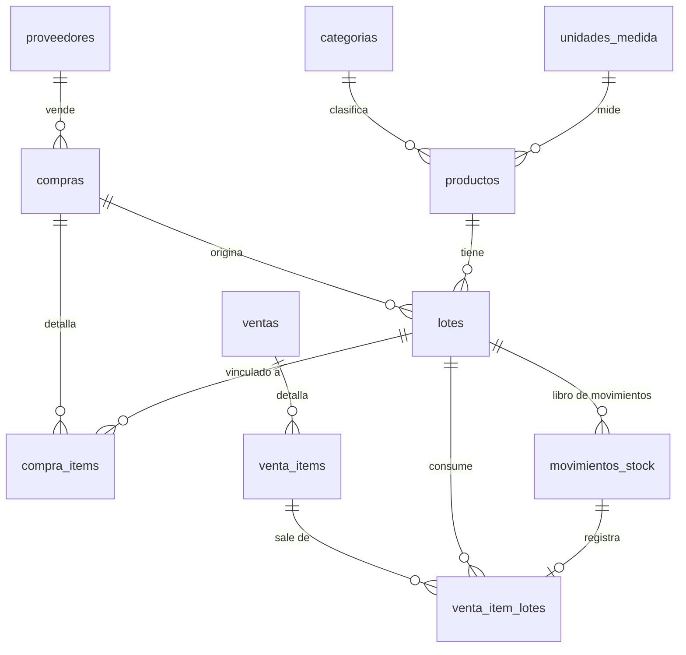

# Lubricentro Salta · Stock y Trazabilidad (demo HTML5)

Prototipo funcional de gestión de stock por lotes para un lubricentro (sin taller ni turnos).
Abrí `index.html` en el navegador: no necesita servidor. Los datos de ejemplo se guardan en `localStorage`
(⚙ Configuración → *Restablecer datos de demo*, y respaldo/restauración en JSON).

## Módulos
| Módulo | Qué hace |
|---|---|
| Productos | Alta, modificación y baja (lógica si tiene historial). Código de barras/QR, marca, categoría, unidad, stock mínimo, punto de reorden, precio, controla vencimiento. |
| Inventario y lotes | Stock por producto y por lote; qué lote sale primero según FEFO/FIFO. |
| Proveedores | Datos de contacto, baja lógica. |
| Compras | Ingreso de remito/factura; cada renglón crea (o completa) un **lote** con vencimiento. Rechaza comprobantes duplicados; es todo-o-nada. |
| Ventas | Escáner (Enter) o búsqueda. Lote automático por FEFO/FIFO o elegido a mano; una venta puede salir de varios lotes. Ticket con lotes de salida. |
| Ajustes y mermas | Merma, rotura, baja por vencimiento, ajuste ±. Siempre contra un lote y con motivo obligatorio. |
| Alertas | Vencidos con stock, stock crítico, próximos a vencer (días configurables), punto de reorden. |
| Trazabilidad | Por lote: proveedor, comprobante, ingreso, vencimiento y cadena de movimientos con saldo corrido (clic desde ventas, alertas, compras). |
| Reportes | Movimientos por lote (filtros + CSV) y valorización de stock por lote/categoría (+ CSV, imprimir). |

## Modelo de datos (`schema.sql`, PostgreSQL)

**Regla central:** el stock no se guarda; es la suma de `movimientos_stock` por lote (cantidad con signo).
Triggers: los movimientos no se editan ni borran (se corrigen con otro movimiento) y un lote nunca queda en negativo.
Vistas: `v_stock_lote`, `v_stock_producto`, `v_alertas_stock`, `v_alertas_vencimiento`, `v_valorizacion`, `v_trazabilidad_lote`.
`fn_sugerir_lotes(producto, cantidad, 'FEFO'|'FIFO')` devuelve los lotes a descontar (excluye vencidos).

## Flujo de datos
1. **Compra** → cabecera + renglones → `lotes` (nro, vencimiento, costo) → movimiento `ENTRADA`.
2. **Venta** → por renglón se asignan lotes (FEFO: vence antes, desempata por ingreso; FIFO: ingreso) → movimientos `VENTA` negativos + detalle por lote.
3. **Ajuste/merma/vencido** → movimiento negativo (o `AJUSTE_POS`) sobre un lote, con motivo.
4. **Alertas y reportes** se calculan siempre desde el libro: stock disponible = lotes no vencidos.

## Verificación realizada
- Demo en Chromium headless: las 10 pantallas cargan sin errores de consola; FEFO reparte 60 L entre dos lotes (51 + 9) por vencimiento; los lotes vencidos no se venden; comprobante duplicado rechazado; compra con un renglón inválido se revierte completa; ajuste mayor al stock rechazado; ningún lote queda negativo.
- `schema.sql` ejecutado en PostgreSQL real: crea sin errores, FEFO/FIFO devuelven el orden esperado, y los triggers/CHECK bloquean stock negativo, edición de movimientos y ajustes sin motivo.

## Límites de la demo
Sin usuarios ni permisos, sin facturación fiscal, sin conexión a servidor (datos sólo en el navegador).
`schema.sql` es la base para la versión con servidor; la demo no lo consume.

Desarrollado por **VINCULAR BUSINESS** · (387) 4484132 · vincularbusiness@gmail.com · *Tu idea, en buenas manos.*
